# ☕ Brewly

**Brewly** je webová aplikace pro objednávání přímo ke stolu. Zákazník ji otevře v mobilu přes QR kód na stole, bez instalace, a objedná si sám. Je to můj maturitní projekt ve **Flutteru** s databází **Firebase**.

Obsluha vidí objednávky, požadavky i rezervace živě. Vedoucí podniku (admin) si v aplikaci sám spravuje menu, vzhled i provoz. Aplikace je navržená pro kavárnu, ale díky nastavení ji může používat i bar, cukrárna, pivnice nebo restaurace.

🌐 **Vyzkoušet:** [brewly-9e944.web.app](https://brewly-9e944.web.app)

| V kostce | |
|---|---|
| **Pro koho** | zákazník (host), obsluha, admin (vedoucí podniku) |
| **Kde běží** | v prohlížeči, na počítači i v mobilu |
| **Technologie** | Flutter / Dart, Firebase (Authentication, Firestore, Hosting) |
| **Zabezpečení** | bezpečnostní pravidla databáze na serveru |
| **Testy** | 89 testů aplikace + 70 testů bezpečnostních pravidel |

---

## 📋 Obsah

1. [💡 Proč Brewly vzniklo](#-proč-brewly-vzniklo)
2. [✨ Co aplikace umí](#-co-aplikace-umí)
3. [📸 Ukázky](#-ukázky)
4. [🛠️ Technologie](#️-technologie)
5. [🧭 Jak to funguje](#-jak-to-funguje)
6. [⚙️ Konfigurace vs. databáze](#️-konfigurace-vs-databáze)
7. [🗄️ Databáze](#️-databáze)
8. [🔒 Zabezpečení](#-zabezpečení)
9. [📁 Struktura projektu](#-struktura-projektu)
10. [🚀 Spuštění projektu](#-spuštění-projektu)
11. [🧪 Testy](#-testy)
12. [💰 Návrh zpoplatnění](#-návrh-zpoplatnění)
13. [🗺️ Plánované funkce](#️-plánované-funkce)

---

## 💡 Proč Brewly vzniklo

Sama pracuji v kavárně a každý den vidím, kolik času zabere obyčejné objednávání. Chodím od stolu ke stolu, zapisuji si objednávky, běhám k baru a zpátky. Když je plno, zákazníci čekají, až si jich někdo všimne. A když chtějí zaplatit, musí mávat přes celou místnost.

Chtěla jsem, aby to šlo jednodušeji, pro zákazníky i pro nás za barem:

- **zákazník** si objedná sám ze stolu, kdy se mu to hodí, a vidí, v jakém stavu jeho objednávka je,
- **obsluha** má všechny objednávky přehledně na jednom místě a hned ví, ke kterému stolu co nést,
- **přivolat obsluhu** nebo **požádat o účet** jde jedním klepnutím,
- **vedoucí** si menu, ceny i vzhled aplikace upraví sám, bez programátora.

Kavárna, ve které pracuji, mi byla inspirací. Aplikaci jsem ale od začátku navrhovala tak, aby si ji mohl přizpůsobit jakýkoli podnik.

---

## ✨ Co aplikace umí

Aplikace rozlišuje čtyři typy uživatelů. Co kdo smí, nehlídá jen aplikace, ale i bezpečnostní pravidla databáze.

| Role | Ve zkratce |
|---|---|
| 👤 **Návštěvník** | prohlíží si menu a informace o podniku |
| ☕ **Zákazník** | objednává ke stolu, sleduje objednávku, rezervuje stůl, sbírá razítka |
| 👩‍🍳 **Obsluha** | vyřizuje objednávky, požadavky a rezervace, zapisuje docházku |
| 🧑‍💼 **Admin** | totéž co obsluha + menu, nastavení podniku, statistiky, zaměstnanci |

### 👤 Návštěvník (nepřihlášený)
- prohlíží si **menu** podle kategorií a detail produktu,
- vidí **informace o podniku** (adresa, otevírací doba, Wi-Fi),
- může si naplnit košík, před objednáním se ale musí přihlásit.

### ☕ Zákazník

**Objednávání**
- **QR kód na stole** otevře rovnou menu a aplikace ví, u kterého stolu zákazník sedí. Stůl jde zadat i opsaným kódem.
- **Košík** hlídá vyprodané produkty a změny cen. V menu je **plovoucí lišta košíku** („2 položky · 135 Kč“).
- Po odeslání objednávky se hned otevře **sledování s ukazatelem průběhu** (Přijata → Připravuje se → Připravena → Dokončena).
- **Upozornění „Vaše objednávka je připravená! 🎉“** se ukáže, ať je zákazník v aplikaci kdekoli.
- Tlačítka **Přivolat obsluhu** a **Chci zaplatit**.
- **Historie objednávek** s detailem.

**Navíc**
- **Rezervace stolu** z úvodní obrazovky: den, čas, počet osob a poznámka. Nabízí se jen dny a časy, které podnik nastavil. Rezervaci potvrzuje obsluha, zákazník ji může zrušit a najednou smí mít nejvýš 3 nadcházející.
- **Razítková karta** (např. každá 10. káva zdarma): za každý kus z vybrané kategorie jedno razítko. S plnou kartou se v košíku objeví **Uplatnit odměnu**.
- **Oblíbené produkty**: srdíčko u produktu a štítek „Oblíbené“ v menu.

**Účet**
- registrace a přihlášení **e-mailem a heslem** nebo **přes Google**, obnovení zapomenutého hesla,
- **profil**: avatar (ikonka a barva, nebo fotka z Google), změna jména a hesla,
- **světlý / tmavý vzhled**, nebo podle systému. Volba se uloží k účtu.

### 👩‍🍳 Obsluha
- **úvodní obrazovka s barevnými dlaždicemi** (Objednávky, Rezervace, Docházka, Stoly), přepínačem **Otevřeno / Zavřeno** a živými čísly,
- **červená čísla na dlaždicích** ukazují, co čeká na vyřízení (nové objednávky a požadavky, nepotvrzené rezervace),
- **objednávky** v záložkách Požadavky, Aktivní a Dokončené, posun do dalšího stavu jedním tlačítkem,
- **rezervace**: nahoře čekající žádosti, pod nimi potvrzené po dnech. Při potvrzení jde rovnou přidělit stůl. Stůl, který má v tu dobu jiná rezervace, nejde vybrat.
- **upozornění „Brzy přijdou hosté s rezervací“** hodinu předem (stůl, čas, počet osob), aby obsluha stůl včas uvolnila,
- **QR kódy stolů** k vytištění (obnovit je smí jen admin),
- **docházka** (jako v pokladním systému Dotykačka): Příchod, Odchod a odpracované hodiny za měsíc.

### 🧑‍💼 Admin (vedoucí podniku)
Umí všechno co obsluha, a navíc:
- **ovládací panel** na úvodu: dnešní tržba, aktivní objednávky a osm dlaždic. Každý nástroj má pořád stejnou barvu, aby si ji člověk zapamatoval. **Zobrazit jako zákazník** ukáže menu očima hosta (jen náhled, objednat z něj nejde).
- **správa menu**: přidání, úprava a smazání produktu, **vyprodáno**, vyhledávání, výběr ikony, **nahrání celého menu z CSV** (např. z Excelu) s kontrolou chyb,
- **kategorie**: přidání, přejmenování, smazání a řazení přetažením,
- **nastavení podniku**:
  - název, slogan, typ podniku a **barva aplikace** z 8 palet (přebarví se živě i zákazníkům),
  - **oznámení v menu** (např. „Dnes −20 % na dezerty“) a informace pro zákazníky,
  - **razítková karta**: zapnutí, kategorie a kolikátý kus je zdarma (3.–20.),
  - **časy rezervací** pro každý den v týdnu,
  - při odchodu s neuloženými změnami se aplikace zeptá, jestli je uložit,
- **statistiky** za dnešek, týden nebo měsíc: tržba, počet objednávek a průměrná útrata se **srovnáním s předchozím obdobím**, interaktivní graf tržeb, nejprodávanější produkty, tržba podle kategorií a vydané odměny,
- **docházka zaměstnanců**: kdo je právě v práci, hodiny každého za měsíc a **ukončení zapomenuté směny** (po 12 hodinách aplikace upozorní),
- **zaměstnanci**: přidání nového zaměstnance do obsluhy jedním klepnutím, případně odebrání,
- **obnovení QR kódů stolů**, kdyby kód unikl.

---

## 📸 Ukázky

Klepnutím na název skupiny se snímky rozbalí.

<details>
<summary><b>☕ Zákazník: menu, oblíbené, rezervace, razítková karta</b></summary>

&nbsp;

**Menu s vlastními ikonami nápojů.** Každý druh kávy má svůj šálek nebo sklenici, aplikace je kreslí sama. Dole plovoucí lišta košíku.

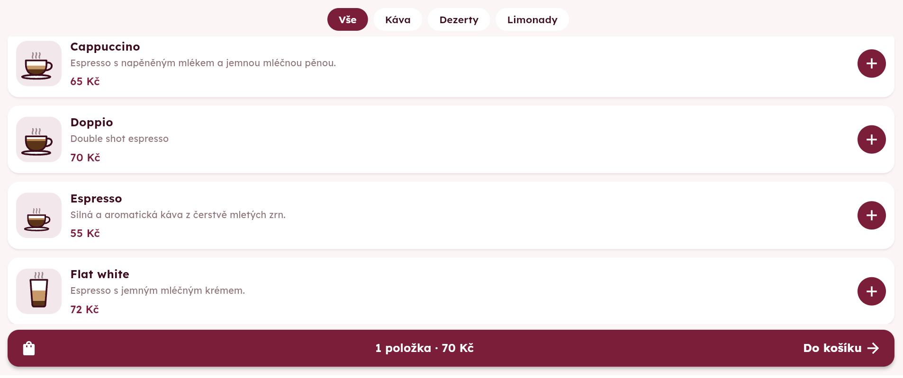

**Oblíbené produkty.** Zákazník si srdíčkem označí, co si dává nejčastěji. Hned za „Vše“ se objeví štítek Oblíbené, který ukáže jen tyto produkty. Oblíbené se ukládají k účtu, takže je zákazník uvidí i na jiném zařízení.

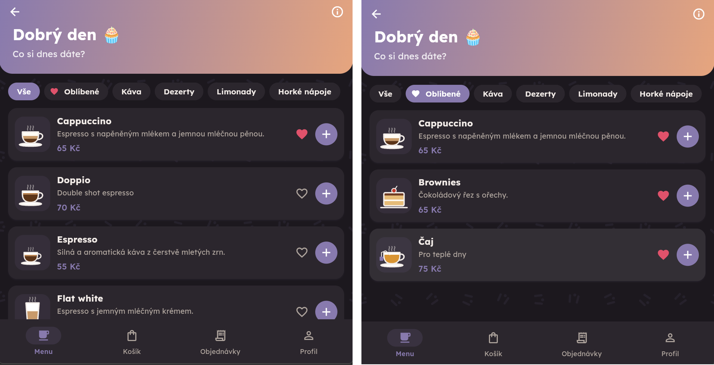

**Rezervace stolu.** Zákazník vybere den, čas a počet osob. Obsluha vidí čekající žádosti nahoře a při potvrzení může rovnou přidělit stůl.

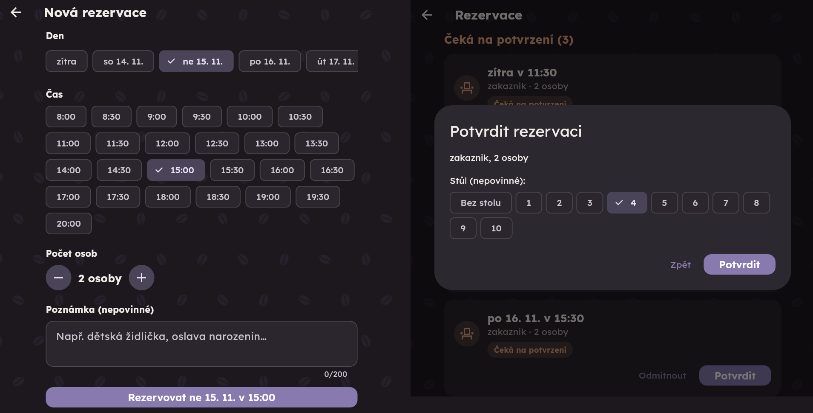

**Razítková karta.** Vlevo karta zákazníka v profilu: za každou kávu razítko, 10. políčko je dárek a při plné kartě zezelená. Vpravo admin v nastavení zvolí kategorii a kolikátý kus je zdarma.

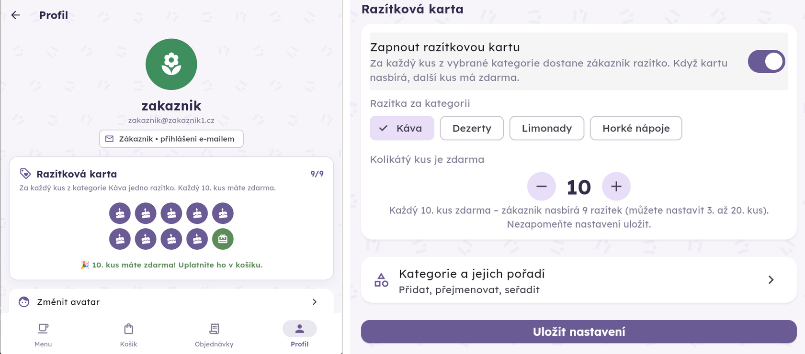

**Uplatnění odměny v košíku.** S plnou kartou se v košíku objeví tlačítko. Po stisknutí je jeden kus zdarma a cena se sníží.

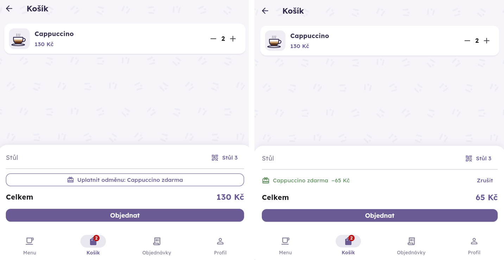

**Tmavý režim.** Každý si v profilu (obsluha a admin tlačítkem s měsícem na úvodu) vybere světlý nebo tmavý vzhled, případně „Systém“ podle nastavení zařízení. Tmavé varianty všech palet aplikace dopočítá sama.

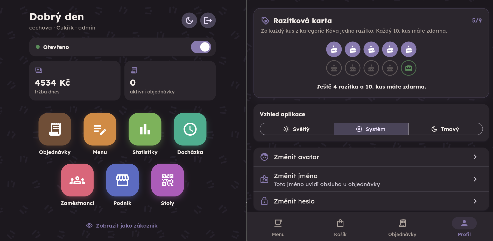

</details>

<details>
<summary><b>👩‍🍳 Obsluha a admin: úvod, docházka, zaměstnanci, statistiky</b></summary>

&nbsp;

**Úvod pro admina a obsluhu.** Po přihlášení zaměstnanec místo menu vidí ovládací panel: přepínač Otevřeno, živá čísla a barevné dlaždice. Pozadí se mění podle palety podniku, barvy dlaždic zůstávají. (Snímek je z doby před přidáním rezervací, dnes má admin 8 dlaždic a obsluha 4.)

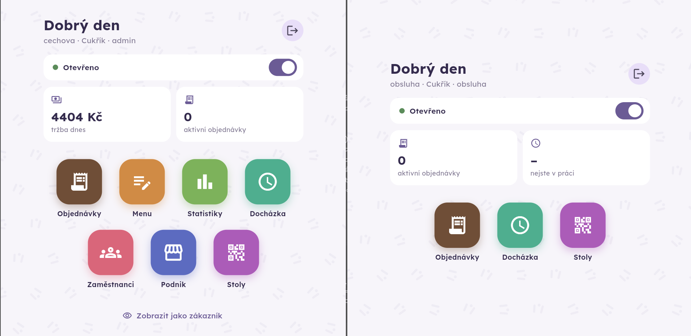

**Červená čísla na dlaždicích** ukazují, co čeká na vyřízení: nové objednávky a požadavky zákazníků, nepotvrzené rezervace a u admina možná zapomenuté odchody.

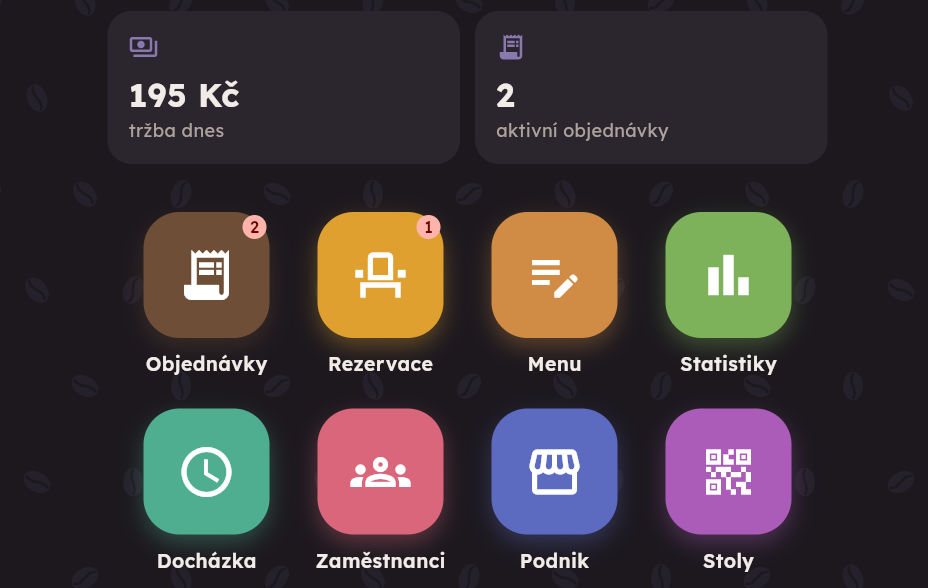

**Kontrola odměny u obsluhy.** Obsluha u objednávky vidí, který kus je zdarma, a aplikace jí potvrdí, že zákazník měl kartu opravdu plnou. Vpravo stejná objednávka u zákazníka.

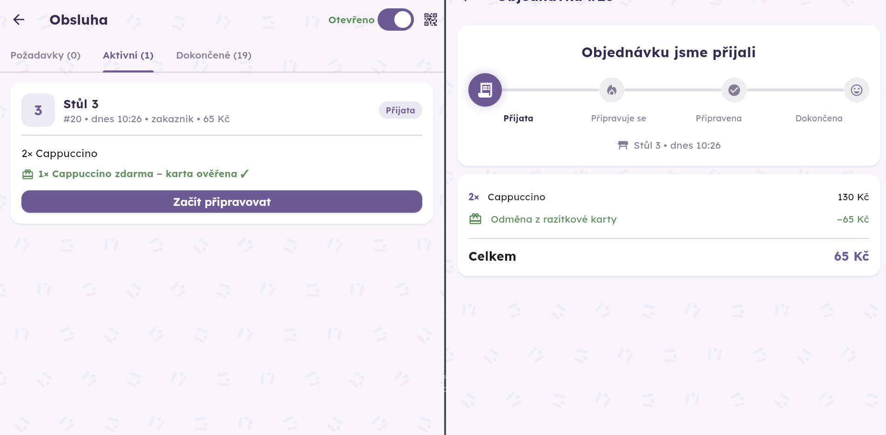

**Docházka.** Vpravo obsluha: Příchod / Odchod a odpracované hodiny za měsíc. Vlevo admin: kdo je v práci a kolik kdo odpracoval.

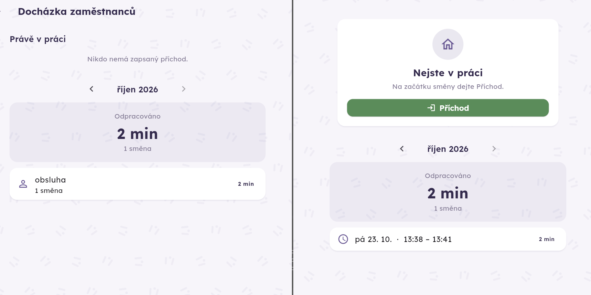

**Zapomenutý odchod.** Admin zadá čas odchodu (čas v budoucnosti aplikace nepřijme). Směna pak má poznámku „Odchod doplnil admin“.

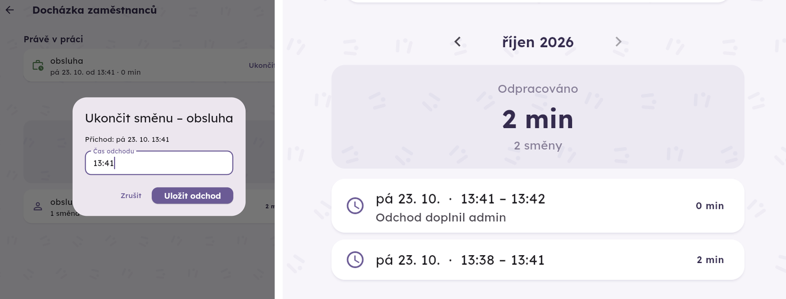

**Zaměstnanci.** Admin přidá nového zaměstnance do obsluhy jedním klepnutím. Zaměstnanec se zaregistruje jako zákazník a admin ho tu vyhledá. E-maily jsou na snímku rozmazané.

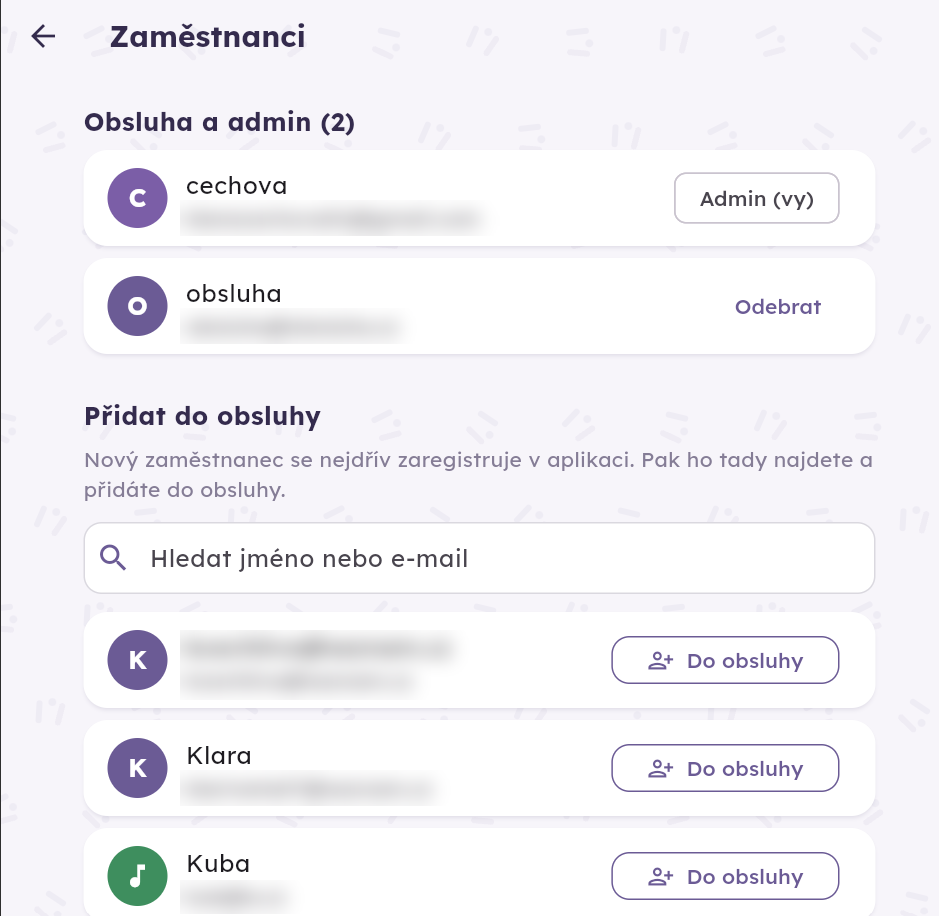

**Statistiky.** Tržba, počet objednávek a průměrná útrata se srovnáním s předchozím obdobím, graf tržby (klepnutím na sloupec se ukáže detail), nejprodávanější produkty a tržba podle kategorií.

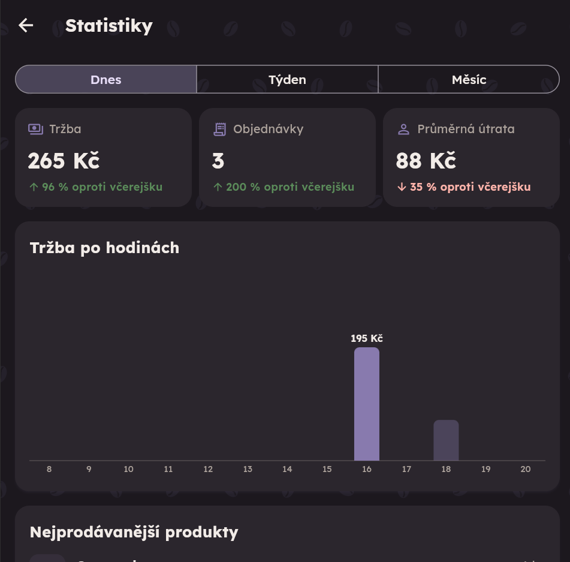

</details>

<details>
<summary><b>🧑‍💼 Admin: nastavení podniku, menu, CSV, časy rezervací</b></summary>

&nbsp;

**Úvodní obrazovka podle typu podniku.** Admin zvolí typ podniku a barvu: změní se ilustrace (u kavárny s animovanou párou) i vzor v pozadí celé aplikace. Kavárna má kávová zrnka, cukrárna posypky, bar hvězdičky a pivnice bublinky.

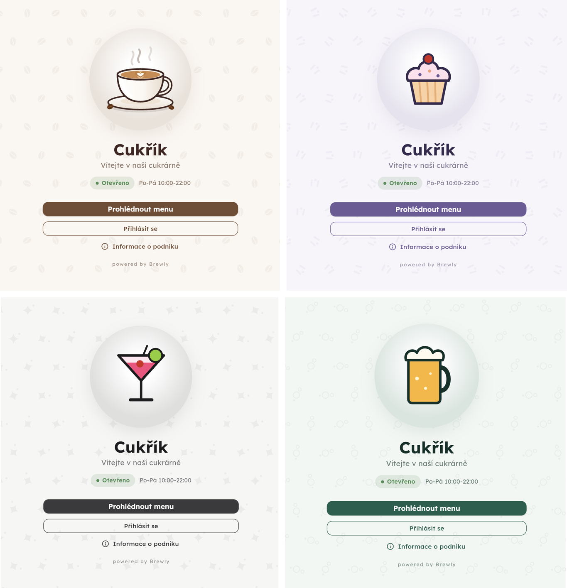

**Přizpůsobení podniku.** Admin změní název, typ podniku a barvu. Vpravo živý náhled, vlevo stejná aplikace přebarvená pro cukrárnu „Cukřík“.

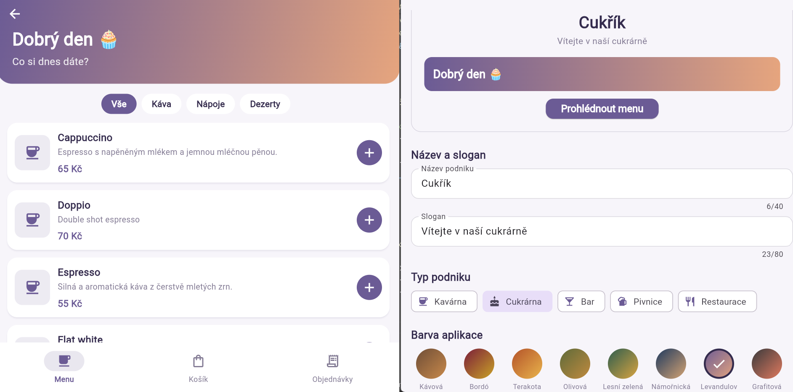

**Časy rezervací.** Každý podnik má jinou otevírací dobu, proto admin pro každý den v týdnu určí první a poslední čas rezervace, nebo den vypne. Zákazníkovi se pak nabízí jen tyto dny a časy (na snímku vpravo chybí neděle).

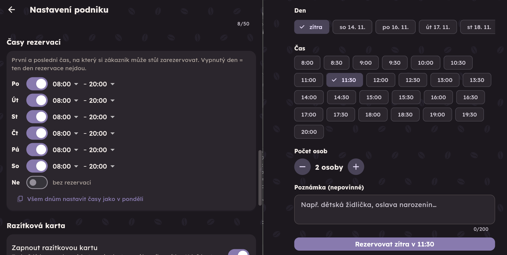

**Košík a správa menu.** Vlevo košík zákazníka: produkt, který admin mezitím označil jako vyprodaný, se zešedí a objednat nejde, dokud ho zákazník neodebere. Vpravo správa menu s vyhledáváním a přepínačem vyprodáno.

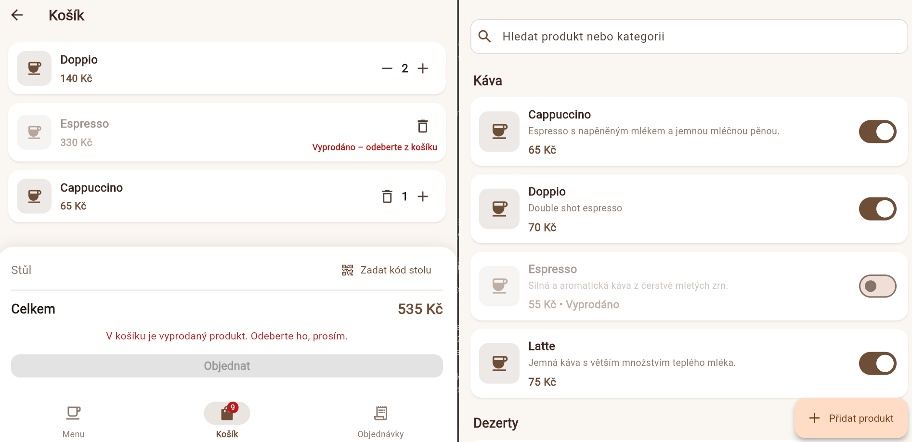

**Výběr ikony produktu.** Admin ikonu vybere, nebo nechá „Automaticky“ a aplikace ji odhadne podle názvu.

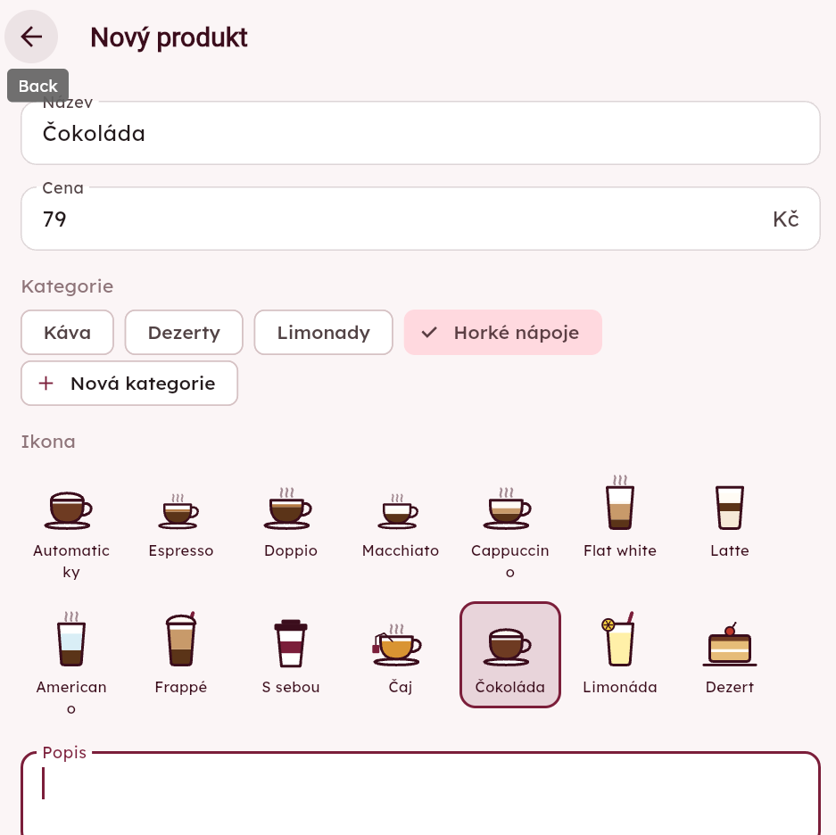

**Nahrání menu ze souboru CSV.** Návod, jak má soubor vypadat, a výběr souboru (např. uloženého z Excelu).

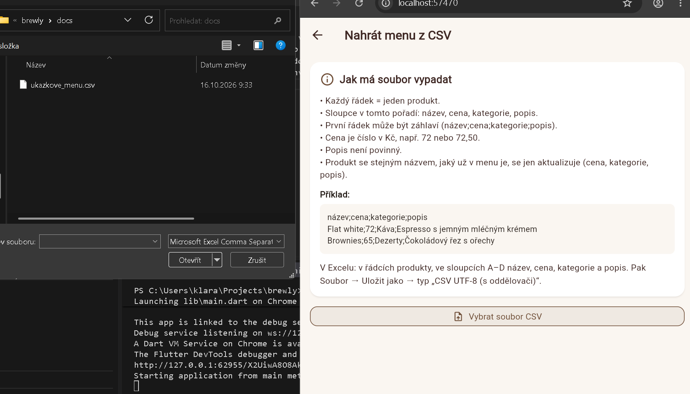

**Kontrola CSV před uložením.** Aplikace soubor zkontroluje řádek po řádku. Chybné řádky ukáže červeně a nenahraje je, správné produkty ukáže v náhledu.

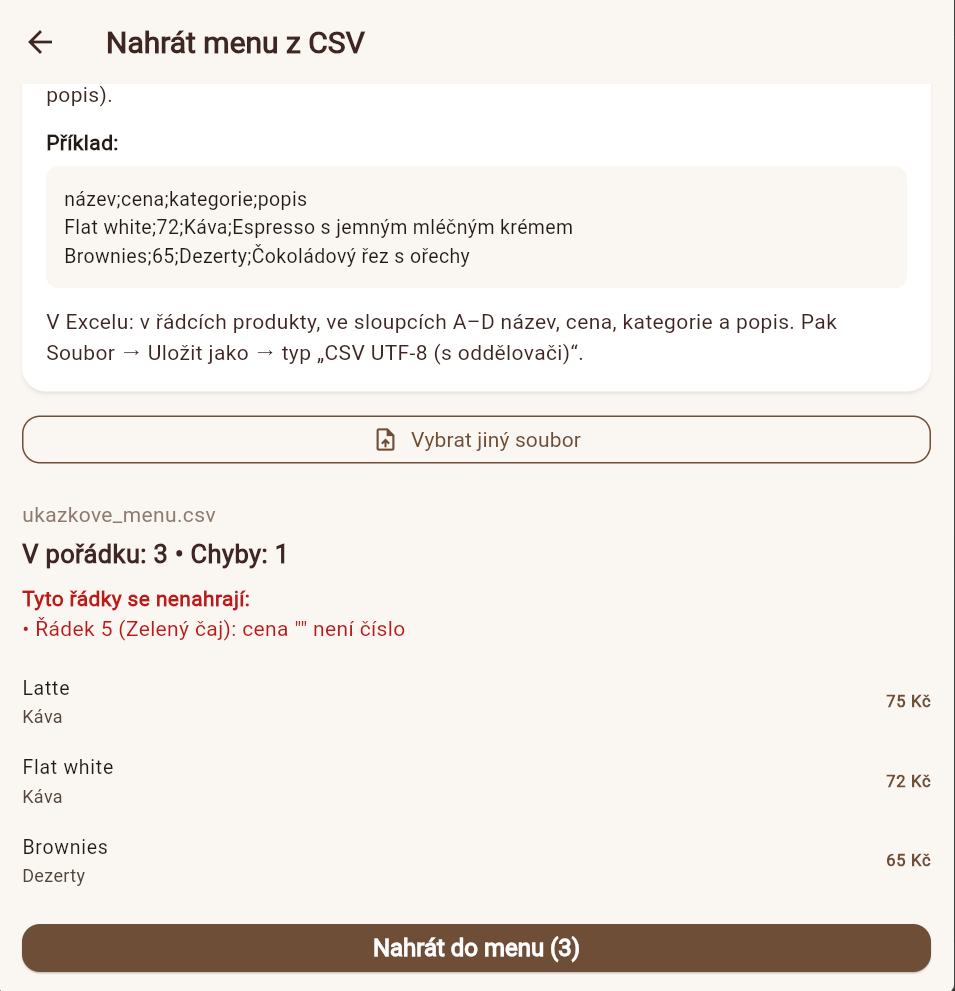

</details>

---

## 🛠️ Technologie

| Technologie | K čemu ji používám |
|---|---|
| **Flutter / Dart** | celá aplikace (webová aplikace, funguje v prohlížeči na počítači i v mobilu) |
| **Firebase Authentication** | registrace a přihlášení (e-mail + heslo, Google) |
| **Cloud Firestore** | databáze s živými aktualizacemi |
| **Firestore Security Rules** | kdo smí co číst a měnit (zabezpečení na straně serveru) |
| **Firebase Hosting** | zveřejnění aplikace na webu |
| **CustomPainter** (Flutter) | aplikace sama kreslí grafy ve statistikách, ikony nápojů, ilustraci na úvodu (s animovanou párou) a vzor v pozadí a přebarvuje je podle barvy podniku |
| písmo **Lexend** | písmo navržené pro snadné čtení, přibalené přímo v aplikaci |
| `qr_flutter` | generování QR kódů stolů |
| `file_picker` | výběr CSV souboru s menu |
| `fake_cloud_firestore`, `firebase_auth_mocks` | falešná databáze a přihlášení pro testy |

---

## 🧭 Jak to funguje

Zákazník, obsluha i admin používají stejnou aplikaci, každý vidí jen svou část podle role. Aplikace je napsaná ve Flutteru a běží v prohlížeči. Data ukládá do Firebase a každý zápis do databáze nejdřív zkontrolují bezpečnostní pravidla.

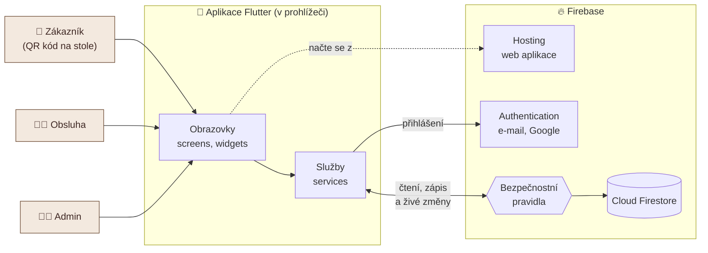

- Aplikace se načte z **Firebase Hosting** (čárkovaná šipka).
- Obrazovky volají **služby**, které zajišťují přihlášení a práci s databází.
- Šipka mezi službami a pravidly vede oběma směry: aplikace data čte a zapisuje a databáze jí sama posílá změny. Nová objednávka se tak obsluze ukáže hned.

---

## ⚙️ Konfigurace vs. databáze

Nastavení aplikace je rozdělené na dvě části podle toho, **kdo ho mění a kdy**:

| | **Konfigurační soubor** | **Databáze** (`settings/venue`) |
|---|---|---|
| Kdo mění | programátor | vedoucí podniku (admin) v aplikaci |
| Kdy | při nasazení aplikace pro podnik | kdykoli za provozu |
| Jak se změna projeví | upravit soubor, znovu sestavit a nahrát aplikaci | **hned, všem zákazníkům** |
| Co obsahuje | adresa aplikace, **počet stolů**, délka kódu stolu, **barevné palety**, výchozí vzhled, limity (max. cena, délky textů, počet položek, počet osob a rezervací…) | název, slogan, typ podniku, barva, otevřeno/zavřeno, oznámení, adresa, otevírací doba, Wi-Fi, razítková karta, časy rezervací |

Konfigurace je v souborech [`lib/config/app_config.dart`](lib/config/app_config.dart) a [`lib/config/palettes.dart`](lib/config/palettes.dart).

**Proč nastavení podniku není taky v souboru?** Vedoucí podniku není programátor. Když ráno zavírá kvůli nemoci, mění akci dne nebo heslo na Wi-Fi, musí to zvládnout sám z mobilu a změna se musí hned projevit všem zákazníkům. To konfigurační soubor neumí, databáze ano.

---

## 🗄️ Databáze

### Proč Firestore (NoSQL)
Používám **Cloud Firestore**. Je to **NoSQL** databáze: data nejsou v tabulkách s řádky, ale v **kolekcích**, které obsahují **dokumenty** (podobné JSONu). Pro mou aplikaci má dvě velké výhody:

- **živé aktualizace**: když zákazník objedná, obsluze se objednávka ukáže okamžitě, bez obnovování stránky,
- **přímé napojení na přihlašování**: bezpečnostní pravidla znají přihlášeného uživatele a jeho roli.

### Diagram databáze
Klasický ER diagram je stavěný pro relační databáze s tabulkami a cizími klíči. Firestore pracuje s **kolekcemi dokumentů**, proto diagram ukazuje kolekce, jednotlivé dokumenty a **odkazy mezi nimi**.

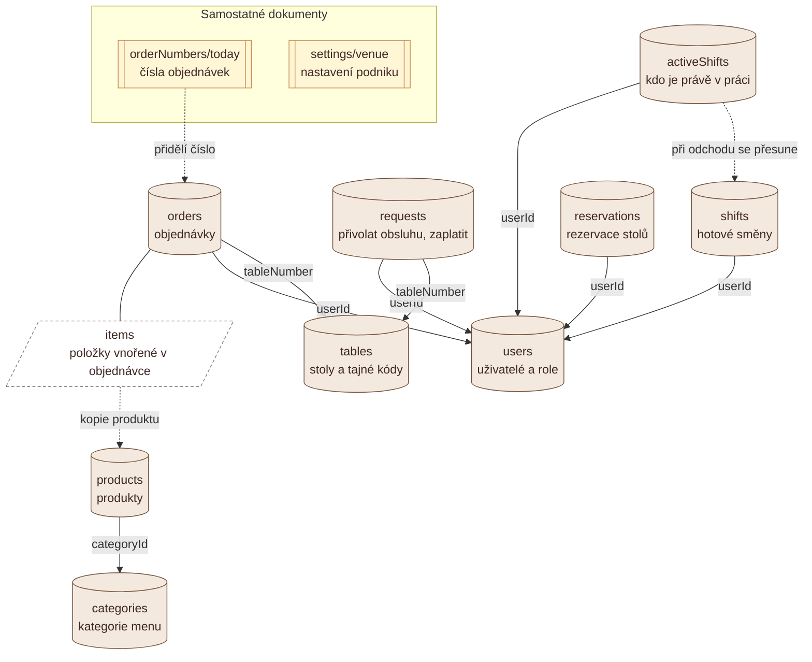

**Legenda:**
- **válec** = kolekce (mnoho dokumentů, např. všechny objednávky),
- **dvojitý obdélník** = jediný samostatný dokument,
- **kosodélník** = data vnořená uvnitř dokumentu (položky objednávky),
- **plná šipka** = odkaz pomocí ID (jako cizí klíč, správnost hlídají pravidla),
- **čárkovaná šipka** = kopie dat nebo přidělení čísla.

### Přehled kolekcí

| Kolekce | Co obsahuje | Odkazuje na |
|---|---|---|
| `users` | uživatelé, role, avatar, vzhled, oblíbené | – |
| `categories` | kategorie menu a jejich pořadí | – |
| `products` | produkty menu | `categories` |
| `orders` | objednávky s vnořenými položkami | `users`, `tables` |
| `orderNumbers/today` | poslední číslo objednávky (náhrada AUTO_INCREMENT) | – |
| `requests` | Přivolat obsluhu, Chci zaplatit | `users`, `tables` |
| `reservations` | rezervace stolů | `users` |
| `tables` | stoly a jejich tajné kódy | – |
| `activeShifts` | kdo je právě v práci | `users` |
| `shifts` | hotové směny (docházka) | `users` |
| `settings/venue` | nastavení podniku | – |

<details>
<summary><b>Pole všech kolekcí (tabulky)</b></summary>

&nbsp;

#### `users`: uživatelé
| Pole | Typ | Popis |
|---|---|---|
| `uid` | text (ID dokumentu) | ID účtu z Firebase Authentication |
| `name` | text | jméno |
| `email` | text | e-mail |
| `role` | text | `zakaznik` / `obsluha` / `admin` |
| `createdAt` | čas | kdy byl profil založen |
| `avatarIcon`, `avatarColor` | text | vybraný avatar (ikonka a barva) |
| `themeMode` | text | vzhled: `system` / `light` / `dark` |
| `favorites` | seznam | ID oblíbených produktů (nejvýš 100) |

#### `categories`: kategorie menu
| Pole | Typ | Popis |
|---|---|---|
| `id` | text (ID dokumentu) | |
| `name` | text | např. Káva, Dezerty |
| `order` | číslo | pořadí v menu |

#### `products`: produkty
| Pole | Typ | Popis |
|---|---|---|
| `id` | text (ID dokumentu) | |
| `name` | text | název |
| `price` | číslo | cena v Kč |
| `categoryId` | text | **odkaz na kategorii** (cizí klíč) |
| `description` | text | popis |
| `icon` | text | vybraná ikona nápoje (prázdné = odhad podle názvu) |
| `available` | ano/ne | `false` = vyprodáno |

#### `orders`: objednávky
| Pole | Typ | Popis |
|---|---|---|
| `id` | text (ID dokumentu) | jedinečné ID objednávky |
| `number` | číslo | číslo pro lidi („dvanáctka je hotová“), každý den od 1 |
| `items` | seznam | položky objednávky (ID produktu, název, cena, kategorie, množství) |
| `totalPrice` | číslo | celková cena |
| `tableNumber` | číslo | **odkaz na stůl** |
| `tableCode` | text | tajný kód stolu z QR kódu |
| `status` | text | `prijata` / `pripravujeSe` / `pripravena` / `dokoncena` |
| `userId` | text | **odkaz na uživatele** |
| `customerName` | text | jméno zákazníka pro obsluhu |
| `createdAt` | čas | čas serveru |
| `rewardProductId` | text | jen u odměny z razítkové karty: který produkt byl zdarma |
| `rewardDiscount` | číslo | kolik se za odměnu odečetlo (cena jednoho kusu) |
| `rewardStamps` | číslo | kolik razítek odměna stála **v době objednání** |

#### `orderNumbers/today`: čísla objednávek
| Pole | Typ | Popis |
|---|---|---|
| `last` | číslo | poslední přidělené číslo objednávky |
| `day` | číslo | den, ke kterému číslo patří (`YYYYMMDD`) |

#### `requests`: požadavky na obsluhu
| Pole | Typ | Popis |
|---|---|---|
| `id` | text (ID dokumentu) | `{uid}_{typ}`: každý zákazník má od každého typu jen jeden čekající požadavek (ochrana proti spamu) |
| `type` | text | `obsluha` / `platba` |
| `status` | text | `cekajici` / `vyrizeno` |
| `tableNumber`, `tableCode` | číslo, text | stůl a jeho tajný kód |
| `userId`, `customerName` | text | kdo požadavek poslal |
| `createdAt` | čas | |

#### `reservations`: rezervace stolů
| Pole | Typ | Popis |
|---|---|---|
| `userId`, `customerName` | text | kdo rezervuje |
| `time` | čas | den a čas rezervace |
| `people` | číslo | počet osob (1–12) |
| `note` | text | poznámka zákazníka (nepovinná) |
| `status` | text | `ceka` / `potvrzena` / `odmitnuta` / `zrusena` |
| `tableNumber` | číslo | stůl přidělený obsluhou, `0` = zatím žádný |
| `createdAt` | čas | |

#### `tables`: stoly
| Pole | Typ | Popis |
|---|---|---|
| `number` | číslo (ID dokumentu) | 1–10 |
| `code` | text | tajný kód, který je v QR kódu na stole |

#### `activeShifts`: kdo je právě v práci
| Pole | Typ | Popis |
|---|---|---|
| `id` | text (ID dokumentu) | `uid` zaměstnance: každý má nejvýš jeden záznam, takže Příchod nejde dát dvakrát |
| `userId`, `userName` | text | kdo je v práci |
| `start` | čas | příchod, čas serveru |

#### `shifts`: hotové směny (docházka)
| Pole | Typ | Popis |
|---|---|---|
| `userId`, `userName` | text | čí je směna |
| `start`, `end` | čas | příchod a odchod |
| `edited` | ano/ne | `true` = odchod doplnil admin (zaměstnanec se zapomněl odhlásit) |

#### `settings/venue`: nastavení podniku
Jediný dokument s tím, co **mění admin přímo v aplikaci**:
- vzhled: `name`, `slogan`, `color`, `type`,
- provoz: `isOpen`, `announcement`, `address`, `openingHours`, `wifiName`, `wifiPassword`,
- razítková karta: `loyaltyEnabled`, `loyaltyCategoryId`, `loyaltyGoal` (kolikátý kus je zdarma),
- `reservationHours`: časy rezervací pro každý den v týdnu jako 7 textů `"08:00-20:00"` (prázdný text = ten den rezervace nejdou).

</details>

### Jak se ukládá objednávka
Tady je vidět, k čemu slouží `orderNumbers/today` a co všechno kontrolují pravidla:

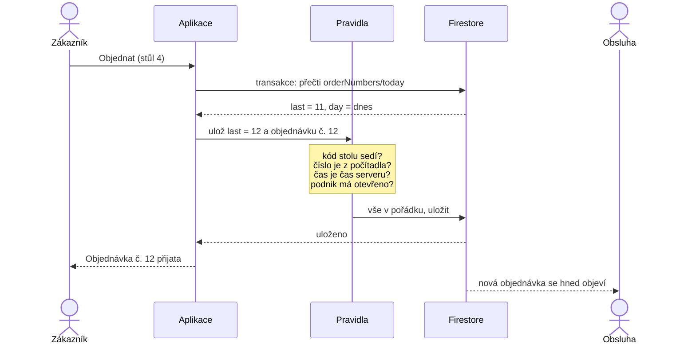

**Čísla objednávek (náhrada AUTO_INCREMENT).** V MySQL by objednávky dostávaly čísla 1, 2, 3… samy díky AUTO_INCREMENT. **Firestore nic takového nemá**: ID dokumentu je náhodný řetězec (např. `xK8f2mQa…`), který se obsluze špatně vyvolává. Proto si v dokumentu `orderNumbers/today` pamatuji poslední přidělené číslo:

1. zákazník odešle objednávku,
2. aplikace v **transakci** přečte `last`, zvýší ho o 1 a stejné číslo uloží do nové objednávky,
3. když je nový den, začne znovu od 1.

Transakce zaručí, že když objednají dva zákazníci ve stejnou chvíli, jeden dostane č. 12 a druhý č. 13, nikdy ne oba stejné číslo. Pravidla navíc hlídají, že číslo opravdu pochází z počítadla a že den se bere z hodin serveru.

**Docházka.** Při Odchodu se v jednom hromadném zápisu (**batch**) vytvoří hotová směna a smaže záznam v `activeShifts`: buď se povede obojí, nebo nic.

### Co se nikam neukládá
Některé údaje aplikace **nepočítá dopředu ani neukládá**, ale spočítá je z existujících dat, podobně jako `SUM`, `COUNT` a `GROUP BY` v SQL. Nemůžou se tak „rozejít“ se skutečností.

| Údaj | Z čeho se počítá |
|---|---|
| **Razítka na kartě** | z objednávek zákazníka podle času: **dokončená** objednávka přidá razítko za každý kus z kategorie karty (kus zdarma ne), objednávka s odměnou odečte `rewardStamps`. Stav „dokončena“ smí nastavit jen obsluha, takže si zákazník razítka sám nepřidá. |
| **Statistiky** | z dokončených objednávek od začátku předchozího období: tržba (už po odečtení odměn), počet, průměrná útrata, nejprodávanější produkty a tržba podle kategorií (seskupení položek), graf po hodinách nebo dnech. Srovnání je férové: dnešek do 14:00 se porovná se včerejškem do 14:00. |
| **Odpracované hodiny** | součet směn v daném měsíci |
| **Červená čísla na dlaždicích** | z objednávek, požadavků, rezervací a docházky, které obsluha stejně sleduje |

Počet razítek na odměnu se ukládá do každé objednávky s odměnou. Když admin později změní „každou 10. kávu“ třeba na „každou 8.“, staré odměny se nepřepočítají. Je to stejný princip jako u ceny: objednávka si pamatuje údaje platné v době nákupu.

### Vztahy
- **uživatel 1 : N objednávky** (`orders.userId` → `users.uid`)
- **uživatel 1 : N požadavky** (`requests.userId` → `users.uid`)
- **uživatel 1 : N rezervace** (`reservations.userId` → `users.uid`)
- **zaměstnanec 1 : N směny** (`shifts.userId` → `users.uid`), **1 : 0..1 právě běžící směna** (`activeShifts/{uid}`)
- **kategorie 1 : N produkty** (`products.categoryId` → `categories.id`)
- **stůl 1 : N objednávky a požadavky** (`tableNumber` → `tables`)
- **objednávka 1 : N položky** (položky jsou vnořené přímo v objednávce)

### Rozdíly oproti relační databázi a proč
| Situace | Řešení v Brewly | Proč |
|---|---|---|
| **Položky objednávky** | vnořený seznam `items` v objednávce, s **kopií** názvu a ceny produktu | Záměrná **denormalizace**. Objednávka si pamatuje cenu v době nákupu, takže zdražení nebo smazání produktu nezmění historii ani tržby. Celá objednávka se navíc načte jedním čtením. |
| **Kategorie** | samostatná kolekce `categories`, produkt na ni odkazuje přes `categoryId` | **Normalizace**: název kategorie je uložený jen jednou. Přejmenování změní jediný dokument a nehrozí překlepy v názvech. |
| **Cizí klíče** | Firestore je sám nehlídá | Hlídají je **bezpečnostní pravidla**, např. produkt nejde uložit s neexistující kategorií a objednávka musí mít platný kód stolu. |
| **Pořadové číslo objednávky** (AUTO_INCREMENT) | dokument `orderNumbers/today` zvyšovaný v **transakci** | Dva zákazníci objednávající ve stejnou chvíli nikdy nedostanou stejné číslo. |
| **Mazání starých dat** | objednávky, rezervace a směny se nemažou | Slouží jako historie (statistiky, razítka, docházka). Obsluha načítá jen dnešní a budoucí data, takže staré záznamy aplikaci nezpomalují. |

---

## 🔒 Zabezpečení

Pravidla v souboru [`firestore.rules`](firestore.rules) běží na serveru Firebase, takže je nejde obejít ani mimo aplikaci. Co je výslovně nepovolené, je zakázané.

| Oblast | Co hlídají pravidla |
|---|---|
| **Role** | zákazník si nemůže sám přidělit roli obsluhy nebo admina. Admin smí jinému účtu přepnout jen zákazník ↔ obsluha, sobě ani jinému adminovi ne. |
| **Oddělení rolí** | obsluha a admin nemůžou vytvářet objednávky, požadavky ani rezervace. Nezkreslují tak statistiky a nemůžou si sami dokončovat objednávky a sbírat razítka. |
| **Objednávky** | zákazník objednává jen sám za sebe, se správným **kódem stolu** a jen když má podnik otevřeno. Objednávka smí mít jen povolená pole, **číslo z počítadla** a **čas serveru**. |
| **Stav objednávky** | mění jen obsluha, a to jen o jeden krok dopředu (Přijata → Připravuje se → Připravena → Dokončena). |
| **QR kódy** | tajné kódy stolů vidí jen obsluha a admin, nové smí vygenerovat jen admin. Kdo u stolu nesedí, nemůže k němu objednat ani přivolat obsluhu. |
| **Požadavky** | ochrana proti spamu: další požadavek jde poslat až po vyřízení předchozího. |
| **Rezervace** | zákazník rezervuje jen sám za sebe, jen do budoucna (nejvýš měsíc dopředu) a pro 1–12 osob. Svou rezervaci smí jen zrušit. Potvrdit nebo odmítnout ji smí jen obsluha. |
| **Menu a nastavení** | mění jen admin. Obsluha smí přepnout jen Otevřeno / Zavřeno. |
| **Čísla objednávek** | nulují se jen v opravdu novém dni podle hodin serveru. |
| **Docházka** | příchod i odchod mají **čas serveru**, ne telefonu. Hotová směna vznikne jen spolu s odchodem. Směny pak nejde změnit ani smazat. Admin smí zadat čas zapomenutého odchodu, ale jen po příchodu a ne v budoucnosti. |
| **Razítková karta** | odměna musí stát přesně tolik razítek, kolik je nastaveno, a jde jen při zapnuté kartě. Objednávka za 0 Kč projde jen s odměnou. |
| **Tvar dat** | všechna data se kontrolují i **tvarem** (typy, délky textů, povolené hodnoty, např. název produktu nejvýš 60 znaků a cena nejvýš 10 000 Kč). |

### Co hlídá aplikace a obsluha (a proč ne pravidla)
Bezpečnostní pravidla neumí projít víc dokumentů najednou ani sečíst seznam. Úplnou kontrolu by musela dělat serverová funkce (**Cloud Functions**), která ale vyžaduje placený tarif Firebase. Proto tyto věci hlídá aplikace, a ty důležité ještě obsluha:

| Co | Kdo to hlídá | Proč to stačí |
|---|---|---|
| **Cena objednávky** | pravidla jen to, že je kladná a rozumně vysoká. Obsluha u každé objednávky vidí **výrazné upozornění**, když součet nesedí nebo cena položky nesouhlasí s menu. | Obsluha objednávku předává osobně a platba probíhá u ní. |
| **Plná razítková karta** | obsluha u objednávky s odměnou vidí „karta ověřena ✓“, nebo červené upozornění | Pravidla by musela projít všechny objednávky zákazníka. |
| **Obsazený stůl u rezervace** | aplikace nedovolí vybrat stůl, který má v tu dobu jiná rezervace | Rezervace potvrzuje vždy obsluha. |
| **Časy rezervací a limit 3 rezervací** | aplikace nabízí jen povolené dny a časy a hlídá limit | Každá rezervace stejně čeká na potvrzení obsluhou. |
| **Smazání jen prázdné kategorie** | aplikace | Smí to jen admin. |

---

## 📁 Struktura projektu

```
lib/
├── main.dart            spuštění aplikace, napojení na Firebase, téma podle nastavení
├── config/              KONFIGURACE: počet stolů, palety, výchozí vzhled, limity
├── models/              datové třídy (Product, Order, Cart, Reservation, VenueSettings…)
├── services/            práce s databází a přihlášením (ProductService, OrderService…)
├── screens/             obrazovky (menu, košík, obsluha, rezervace, správa menu…)
├── widgets/             znovupoužitelné části obrazovek (karta produktu, grafy, okna…)
├── theme/               vzhled aplikace sestavený z vybrané palety
└── utils/               pomocné funkce (formátování cen a dat, čtení CSV…)
test/                    automatické testy aplikace (Dart)
rules_test/              automatické testy bezpečnostních pravidel (JavaScript, emulátor)
docs/                    snímky obrazovky, ukázkové CSV menu
firestore.rules          bezpečnostní pravidla databáze
```

---

## 🚀 Spuštění projektu

Potřebuješ nainstalovaný [Flutter](https://docs.flutter.dev/get-started/install) a prohlížeč Chrome.

```bash
git clone https://github.com/klariiisek/Brewly.git
cd Brewly
flutter pub get
flutter run -d chrome
```

Aplikace se připojí k mému Firebase projektu. Pro vlastní projekt je potřeba nastavit Firebase přes `flutterfire configure` a nahrát pravidla příkazem `firebase deploy --only firestore:rules`.

**Zveřejnění na webu:**
```bash
flutter build web --release
firebase deploy --only hosting
```

---

## 🧪 Testy

```bash
flutter test
```

Projekt má **89 automatických testů** rozdělených do souborů podle témat (`menu_test`, `cart_order_test`, `auth_profile_test`, `staff_test`, `admin_test`, `settings_test`, `utils_test`, `attendance_test`, `loyalty_test`, `stats_test`, `reservation_test`). Používají falešnou databázi a falešné přihlášení v paměti (`fake_cloud_firestore`, `firebase_auth_mocks`), takže se při nich nic neukládá do skutečné databáze.

Testují například:
- objednávku od menu přes košík až po stav u obsluhy,
- role (zákazník nevidí obsluhu, obsluha nevidí správu menu),
- čtení CSV souboru a hlášení chybných řádků,
- denní nulování čísel objednávek a zavřený podnik,
- docházku (příchod, odchod, zapomenutá směna, noční směna přes půlnoc),
- razítkovou kartu (počítání razítek, odměna v košíku, odhalení neoprávněné odměny),
- statistiky (období, férové srovnání, součty, žebříčky, graf),
- rezervace (časy podle nastavení, limit, zrušení, potvrzení se stolem, obsazené stoly, upozornění),
- upozornění na neuložené změny v nastavení.

### Testy bezpečnostních pravidel

Falešná databáze v testech aplikace pravidla nekontroluje. Proto mají pravidla **vlastní testy** ve složce [`rules_test`](rules_test). Běží proti **emulátoru Firestore**, tedy kopii databáze na počítači, která používá skutečný soubor `firestore.rules`. Skutečná databáze se při nich nikdy nezmění.

Testy jsou v JavaScriptu, protože nástroj Firebase pro testování pravidel (`@firebase/rules-unit-testing`) jiný jazyk nepodporuje. Každý test zkouší, že pravidla **povolí** správnou akci, nebo že **zakážou** podvod:

| Soubor | Co testuje |
|---|---|
| `users.test.js` | nikdo si sám nedá roli obsluhy nebo admina, admin mění jen zákazník ↔ obsluha |
| `orders.test.js` | kód stolu, číslo z počítadla, zavřený podnik, odměny, stav jen o krok dopředu |
| `menu_settings.test.js` | menu a nastavení mění jen admin, limity produktů, kódy stolů |
| `requests_reservations.test.js` | ochrana proti spamu u požadavků, rezervace (čas, počet osob, potvrzení) |
| `attendance.test.js` | čas serveru, směna jen spolu s odchodem, oprava zapomenutého odchodu adminem |

Spuštění (potřebuje [Node.js](https://nodejs.org/), [Javu 21](https://adoptium.net/) a Firebase CLI):

```bash
cd rules_test
npm install
npm test
```

Že testy opravdu umí chybu najít, jsem ověřila tak, že jsem v pravidlech schválně vypnula kontrolu kódu stolu. Test „objednávka se špatným kódem stolu NEprojde“ pak selhal.

---

## 💰 Návrh zpoplatnění

> Jen **návrh** do budoucna. Aplikace je teď zdarma a nic z této kapitoly není naprogramované.

**Kdo platí:** hosté aplikaci používají **zdarma**, platí **podnik**. Stejně jako u pokladních systémů by šlo o **měsíční předplatné** (model *SaaS*, software jako služba): podnik si aplikaci nekupuje, ale platí za její používání, aktualizace a provoz serveru.

### Tarify (orientační ceny)

| | **Start** | **Standard** | **Pro** |
|---|:---:|:---:|:---:|
| **Cena** | 290 Kč / měsíc | 590 Kč / měsíc | 990 Kč / měsíc |
| Menu, objednávky přes QR kód, obsluha, požadavky | ✅ | ✅ | ✅ |
| Vzhled podniku (barvy, typ, oznámení) | ✅ | ✅ | ✅ |
| Statistiky | jen dnešek | ✅ | ✅ |
| Rezervace stolů | – | ✅ | ✅ |
| Razítková karta | – | ✅ | ✅ |
| Docházka zaměstnanců | – | – | ✅ |
| Počet stolů | do 10 | do 30 | bez omezení |
| Vlastní doména a aplikace s logem podniku | – | – | ✅ |

- **30 dní zdarma** na vyzkoušení, při **roční platbě** dva měsíce zdarma.
- **Jednorázově za příplatek:** nastavení podniku „na klíč“ (nahrání menu, tisk QR kódů na stoly).
- Ceny jsou odhad: mají pokrýt náklady a být dostupné i pro malou kavárnu. Přesné ceny by chtěly průzkum trhu.

### Do budoucna: online platby
Zákazník by mohl zaplatit přímo v aplikaci přes **platební bránu**. Brána si bere poplatek z každé platby (řádově jednotky procent) a Brewly by mohlo přidat malý poplatek za transakci.

Platby by otevřely i **objednávku předem s vyzvednutím** (kafe s sebou bez fronty). Tu jsem zatím nedělala, protože bez platby předem hrozí, že zákazník nepřijde a podnik zůstane s připravenou objednávkou.

### Náklady provozu

| Položka | Cena | Poznámka |
|---|---|---|
| **Firebase** | do limitů zdarma (tarif Spark), pak platba podle využití (tarif Blaze) | Blaze je potřeba i pro serverové funkce: úplná kontrola ceny, online platby |
| **Google Play** (Android) | jednorázově 25 USD | zveřejnění aplikace v obchodě |
| **App Store** (iPhone) | 99 USD ročně | navíc je potřeba počítač Mac |
| **Doména** | stovky Kč ročně | jen pro tarif Pro |

### Co by se v aplikaci muselo změnit
1. **Víc podniků:** teď platí *jedna instalace = jeden podnik* (vlastní Firebase projekt). Pro prodej buď každý podnik dostane vlastní projekt (jednoduché, ale hodně ruční práce), nebo budou všechny podniky v jednom projektu a každý bude mít svá data odděleně (víc práce, ale lépe se to rozrůstá).
2. **Tarif v databázi:** pravidla by podle tarifu povolila nebo zakázala funkce, např. rezervace jen ve Standard a Pro. Nestačí jen schovat tlačítko, to by šlo obejít.
3. **Registrace podniku a placení předplatného** přes platební bránu s opakovanými platbami.

---

## 🗺️ Plánované funkce

- 📱 **Aplikace pro Android**: stejný kód sestavený jako aplikace do telefonu.
- 📷 **Skener QR kódů přímo v aplikaci**: tlačítko „Naskenovat stůl“.
- 🥛 **Varianty produktů**: jiný druh mléka, bezkofeinová káva.
- 💳 **Online platby** (viz [Návrh zpoplatnění](#-návrh-zpoplatnění)).

---

👩‍💻 **Autorka:** Klára Čechová, maturitní projekt
