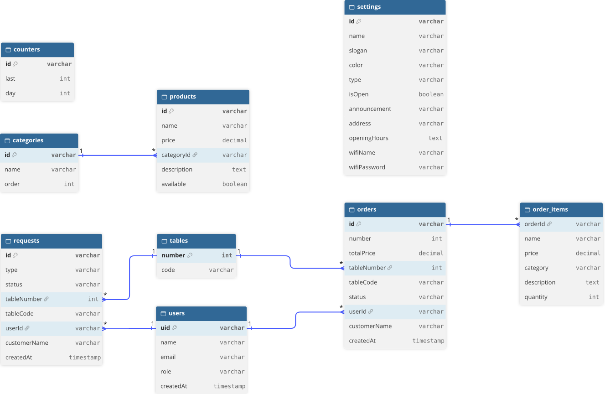

# ☕ Brewly

**Brewly** je webová a mobilní aplikace pro objednávání přímo ke stolu. Je to můj maturitní projekt ve **Flutteru** s databází **Firebase**.

Zákazník naskenuje QR kód na stole, prohlédne si menu, objedná a sleduje, jak se jeho objednávka připravuje. Obsluha vidí objednávky i požadavky zákazníků živě. Vedoucí podniku (admin) si v aplikaci sám spravuje menu, vzhled i provoz. Aplikace je navržená pro kavárnu, ale díky nastavení ji může používat i bar, cukrárna nebo restaurace.

🌐 **Vyzkoušet:** [brewly-9e944.web.app](https://brewly-9e944.web.app)

---

## 📋 Obsah

- [💡 Proč Brewly vzniklo](#-proč-brewly-vzniklo)
- [✨ Co aplikace umí](#-co-aplikace-umí)
- [🛠️ Technologie](#️-technologie)
- [🗄️ Databáze](#️-databáze)
- [🔒 Zabezpečení](#-zabezpečení)
- [📁 Struktura projektu](#-struktura-projektu)
- [🚀 Spuštění projektu](#-spuštění-projektu)
- [🧪 Testy](#-testy)
- [🗺️ Plánované funkce](#️-plánované-funkce)

---

## 💡 Proč Brewly vzniklo

Sama pracuji v kavárně a každý den vidím, kolik času zabere obyčejné objednávání. Chodím od stolu ke stolu, zapisuji si objednávky, běhám k baru a zpátky. Když je plno, zákazníci čekají, až si jich někdo všimne. A když chtějí zaplatit, musí mávat přes celou místnost.

Chtěla jsem, aby to šlo jednodušeji, pro zákazníky i pro nás za barem. Proto jsem se rozhodla vytvořit vlastní aplikaci:

- **zákazník** si objedná sám ze stolu, kdy se mu to hodí, a vidí, v jakém stavu jeho objednávka je,
- **obsluha** má všechny objednávky přehledně na jednom místě a hned ví, ke kterému stolu co nést,
- **přivolat obsluhu** nebo **požádat o účet** jde jedním klepnutím,
- **vedoucí** si menu, ceny i vzhled aplikace upraví sám, bez programátora.

Kavárna, ve které pracuji, mi byla inspirací. Aplikaci jsem ale od začátku navrhovala tak, aby si ji mohl přizpůsobit jakýkoli podnik.

---

## ✨ Co aplikace umí

Aplikace rozlišuje čtyři typy uživatelů. Co kdo smí, nehlídá jen aplikace, ale i bezpečnostní pravidla databáze.

### 👤 Návštěvník (nepřihlášený)
- prohlíží si menu podle kategorií a detail produktu,
- vidí informace o podniku (adresa, otevírací doba, Wi-Fi),
- může si naplnit košík. Před objednáním se musí přihlásit.

### ☕ Zákazník
- registrace a přihlášení **e-mailem a heslem** nebo **přes Google**, obnovení zapomenutého hesla,
- **QR kód na stole** aplikaci řekne, u kterého stolu sedí (stůl jde zadat i opsaným kódem),
- **košík**: změna množství, hlídání vyprodaných produktů a změn cen,
- **objednávka ke stolu** a její **živý stav**: Přijata → Připravuje se → Připravena → Dokončena,
- historie objednávek s detailem,
- tlačítka **Přivolat obsluhu** a **Chci zaplatit**.

### 👩‍🍳 Obsluha
- živý přehled v záložkách **Požadavky**, **Aktivní** a **Dokončené**,
- posouvání objednávek do dalšího stavu jedním tlačítkem,
- vyřizování požadavků zákazníků,
- přepínač **Otevřeno / Zavřeno** (když je zavřeno, nejde objednat),
- **QR kódy stolů** k vytištění a jejich obnovení, kdyby kód unikl.

### 🧑‍💼 Admin (vedoucí podniku)
Umí všechno co obsluha, a navíc:
- **správa menu**: přidání, úprava a smazání produktu, přepínač **vyprodáno**, vyhledávání,
- **nahrání celého menu ze souboru CSV** (např. z Excelu) s kontrolou chyb před uložením,
- **kategorie**: přidání, přejmenování, smazání a řazení přetažením,
- **nastavení podniku**:
  - název, slogan a typ podniku (kavárna, cukrárna, bar, pivnice, restaurace),
  - **barva aplikace** z 8 palet: celá aplikace se přebarví živě, i zákazníkům,
  - **oznámení v menu** (např. „Dnes −20 % na dezerty“),
  - informace pro zákazníky: adresa, otevírací doba, Wi-Fi.

### 📸 Ukázky

**Košík a správa menu.** Vlevo košík zákazníka: produkt, který admin mezitím označil jako vyprodaný, se zešedí a objednat nejde, dokud ho zákazník neodebere. Vpravo správa menu s vyhledáváním a přepínačem vyprodáno.


**Nahrání menu ze souboru CSV.** Návod, jak má soubor vypadat, a výběr souboru (např. uloženého z Excelu).


**Kontrola CSV před uložením.** Aplikace soubor zkontroluje řádek po řádku. Chybné řádky ukáže červeně a nenahraje je, správné produkty ukáže v náhledu.


**Přizpůsobení podniku.** Admin změní název, typ podniku a barvu. Vpravo živý náhled, vlevo stejná aplikace přebarvená pro cukrárnu „Cukřík“.


---

## 🛠️ Technologie

| Technologie | K čemu ji používám |
|---|---|
| **Flutter / Dart** | celá aplikace (běží v prohlížeči i na mobilu) |
| **Firebase Authentication** | registrace a přihlášení (e-mail + heslo, Google) |
| **Cloud Firestore** | databáze s živými aktualizacemi |
| **Firestore Security Rules** | kdo smí co číst a měnit (zabezpečení na straně serveru) |
| **Firebase Hosting** | zveřejnění aplikace na webu |
| `qr_flutter` | generování QR kódů stolů |
| `file_picker` | výběr CSV souboru s menu |
| `fake_cloud_firestore`, `firebase_auth_mocks` | falešná databáze a přihlášení pro testy |

---

## 🗄️ Databáze

### Proč Firestore (NoSQL)
Používám **Cloud Firestore**. Je to **NoSQL** databáze: data nejsou v tabulkách s řádky, ale v **kolekcích**, které obsahují **dokumenty** (podobné JSONu). Pro mou aplikaci má dvě velké výhody:

- **živé aktualizace**: když zákazník objedná, obsluze se objednávka ukáže okamžitě, bez obnovování stránky,
- **přímé napojení na přihlašování**: bezpečnostní pravidla znají přihlášeného uživatele a jeho roli.

### ER diagram
Diagram je vytvořený v [dbdiagram.io](https://dbdiagram.io). Jeho zápis je v souboru [`docs/databaze.dbml`](docs/databaze.dbml).



### Kolekce

#### `users`: uživatelé
| Pole | Typ | Popis |
|---|---|---|
| `uid` | text (ID dokumentu) | ID účtu z Firebase Authentication |
| `name` | text | jméno |
| `email` | text | e-mail |
| `role` | text | `zakaznik` / `obsluha` / `admin` |
| `createdAt` | čas | kdy byl profil založen |

#### `categories`: kategorie menu
| Pole | Typ | Popis |
|---|---|---|
| `id` | text (ID dokumentu) | |
| `name` | text | např. Káva, Dezerty |
| `order` | číslo | pořadí v menu |

#### `products`: produkty
| Pole | Typ | Popis |
|---|---|---|
| `id` | text (ID dokumentu) | |
| `name` | text | název |
| `price` | číslo | cena v Kč |
| `categoryId` | text | **odkaz na kategorii** (cizí klíč) |
| `description` | text | popis |
| `available` | ano/ne | `false` = vyprodáno |

#### `orders`: objednávky
| Pole | Typ | Popis |
|---|---|---|
| `id` | text (ID dokumentu) | jedinečné ID objednávky |
| `number` | číslo | číslo pro lidi („dvanáctka je hotová“), každý den od 1 |
| `items` | seznam | položky objednávky (název, cena, kategorie, množství) |
| `totalPrice` | číslo | celková cena |
| `tableNumber` | číslo | **odkaz na stůl** |
| `tableCode` | text | tajný kód stolu z QR kódu |
| `status` | text | `prijata` / `pripravujeSe` / `pripravena` / `dokoncena` |
| `userId` | text | **odkaz na uživatele** |
| `customerName` | text | jméno zákazníka pro obsluhu |
| `createdAt` | čas | čas serveru |

#### `requests`: požadavky na obsluhu
| Pole | Typ | Popis |
|---|---|---|
| `id` | text (ID dokumentu) | `{uid}_{typ}`: každý zákazník má od každého typu jen jeden čekající požadavek (ochrana proti spamu) |
| `type` | text | `obsluha` / `platba` |
| `status` | text | `cekajici` / `vyrizeno` |
| `tableNumber`, `tableCode` | číslo, text | stůl a jeho tajný kód |
| `userId`, `customerName` | text | kdo požadavek poslal |
| `createdAt` | čas | |

#### `tables`: stoly
| Pole | Typ | Popis |
|---|---|---|
| `number` | číslo (ID dokumentu) | 1–10 |
| `code` | text | tajný kód, který je v QR kódu na stole |

#### `counters/orders` a `settings/venue`: samostatné dokumenty
- **`counters/orders`**: `last` (poslední číslo objednávky) a `day` (den `YYYYMMDD`). Nový den znamená čísla od 1.
- **`settings/venue`**: nastavení podniku (`name`, `slogan`, `color`, `type`, `isOpen`, `announcement`, `address`, `openingHours`, `wifiName`, `wifiPassword`).

### Vztahy
- **uživatel 1 : N objednávky** (`orders.userId` → `users.uid`)
- **uživatel 1 : N požadavky** (`requests.userId` → `users.uid`)
- **kategorie 1 : N produkty** (`products.categoryId` → `categories.id`)
- **stůl 1 : N objednávky a požadavky** (`tableNumber` → `tables`)
- **objednávka 1 : N položky** (položky jsou vnořené přímo v objednávce)

### Rozdíly oproti relační databázi a proč
| Situace | Řešení v Brewly | Proč |
|---|---|---|
| **Položky objednávky** | vnořený seznam `items` v objednávce, s **kopií** názvu a ceny produktu | Záměrná **denormalizace**. Objednávka si pamatuje cenu v době nákupu, takže zdražení nebo smazání produktu nezmění historii ani tržby. Celá objednávka se navíc načte jedním čtením. |
| **Kategorie** | samostatná kolekce `categories`, produkt na ni odkazuje přes `categoryId` | **Normalizace**: název kategorie je uložený jen jednou. Přejmenování změní jediný dokument a nehrozí překlepy v názvech. |
| **Cizí klíče** | Firestore je sám nehlídá | Hlídají je **bezpečnostní pravidla**, např. produkt nejde uložit s neexistující kategorií a objednávka musí mít platný kód stolu. |
| **Jedinečné číslo objednávky** | počítadlo `counters/orders` zvyšované v **transakci** | Dva zákazníci objednávající ve stejnou chvíli nikdy nedostanou stejné číslo. |

---

## 🔒 Zabezpečení

Pravidla v souboru [`firestore.rules`](firestore.rules) běží na serveru Firebase, takže je nejde obejít ani mimo aplikaci:

- **role:** zákazník si nemůže sám přidělit roli obsluhy nebo admina,
- **objednávky:** zákazník vytvoří objednávku jen sám za sebe, se správným **kódem stolu** a jen když má podnik otevřeno. Stav objednávky mění jen obsluha,
- **QR kódy:** tajné kódy stolů vidí jen obsluha. Kdo u stolu nesedí, nemůže k němu objednat ani přivolat obsluhu,
- **požadavky:** ochrana proti spamu, další požadavek jde poslat až po vyřízení předchozího,
- **menu a nastavení** mění jen admin. Obsluha smí přepnout jen Otevřeno / Zavřeno,
- **čísla objednávek** se nulují jen v opravdu novém dni podle hodin serveru,
- všechna data se kontrolují i **tvarem** (typy, délky textů, povolené hodnoty).

---

## 📁 Struktura projektu

```
lib/
├── main.dart            spuštění aplikace, napojení na Firebase, téma podle nastavení
├── models/              datové třídy (Product, Order, Cart, VenueSettings…)
├── services/            práce s databází a přihlášením (ProductService, OrderService…)
├── screens/             obrazovky (menu, košík, obsluha, správa menu…)
├── widgets/             znovupoužitelné části obrazovek (karta produktu, okna…)
├── theme/               barvy, palety a vzhled aplikace
└── utils/               pomocné funkce (formátování cen, čtení CSV…)
test/                    automatické testy
docs/                    diagram databáze, ukázkové CSV menu
firestore.rules          bezpečnostní pravidla databáze
```

---

## 🚀 Spuštění projektu

Potřebuješ nainstalovaný [Flutter](https://docs.flutter.dev/get-started/install) a prohlížeč Chrome.

```bash
git clone https://github.com/klariiisek/Brewly.git
cd Brewly
flutter pub get
flutter run -d chrome
```

Aplikace se připojí k mému Firebase projektu. Pro vlastní projekt je potřeba nastavit Firebase přes `flutterfire configure` a nahrát pravidla příkazem `firebase deploy --only firestore:rules`.

**Zveřejnění na webu:**
```bash
flutter build web --release
firebase deploy --only hosting
```

---

## 🧪 Testy

```bash
flutter test
```

Projekt má **42 automatických testů**. Používají falešnou databázi a falešné přihlášení v paměti (`fake_cloud_firestore`, `firebase_auth_mocks`), takže se při nich nic neukládá do skutečné databáze. Testují například:
- objednávku od menu přes košík až po stav u obsluhy,
- role (zákazník nevidí obsluhu, obsluha nevidí správu menu),
- čtení CSV souboru a hlášení chybných řádků,
- denní nulování čísel objednávek,
- zavřený podnik (nejde objednat),
- převod starých dat kategorií.

---

## 🗺️ Plánované funkce

- 👤 **profil zákazníka**: avatar, jméno, změna hesla,
- 🎟️ **razítková karta**: každá 10. káva zdarma,
- 💳 **volba platby** (kartou / hotově) a **sleva 3 % za platbu kartou**,
- 📊 **statistiky pro admina**: tržby, počet objednávek, nejprodávanější produkty,
- 🎨 **vlastní ikony nápojů** podle tvaru šálku a sklenice.

---

👩‍💻 **Autorka:** Klára Čechová, maturitní projekt
